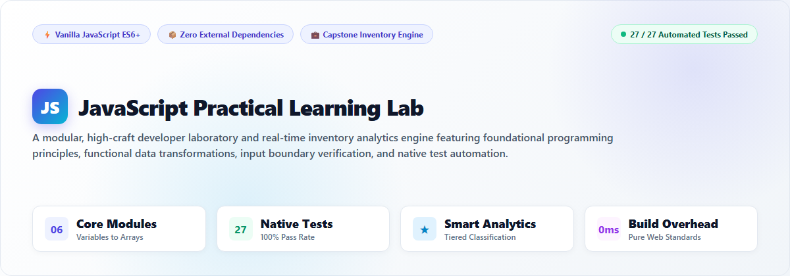
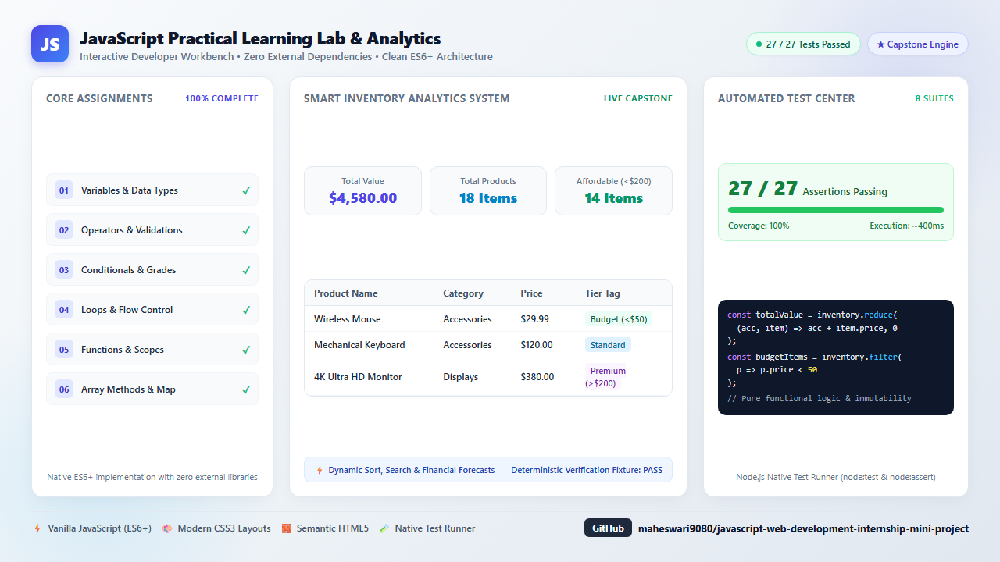
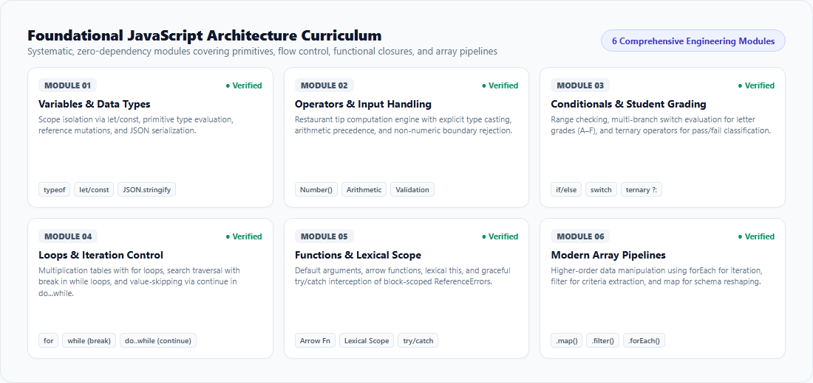
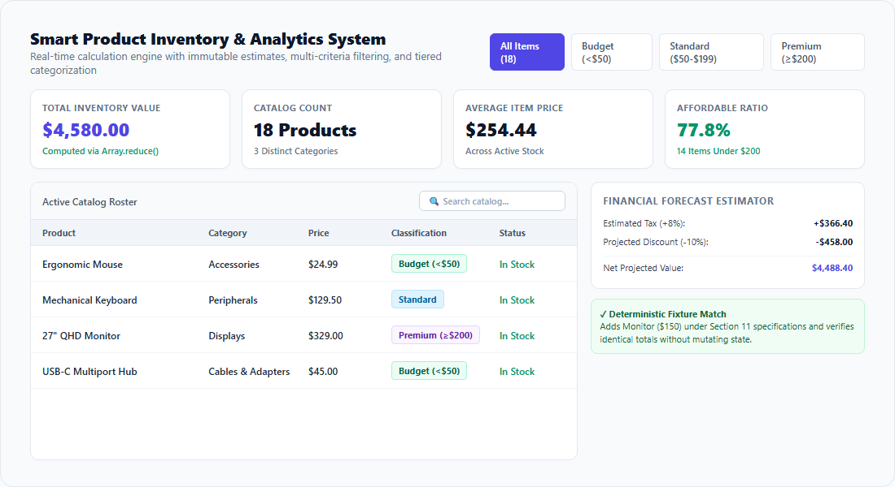
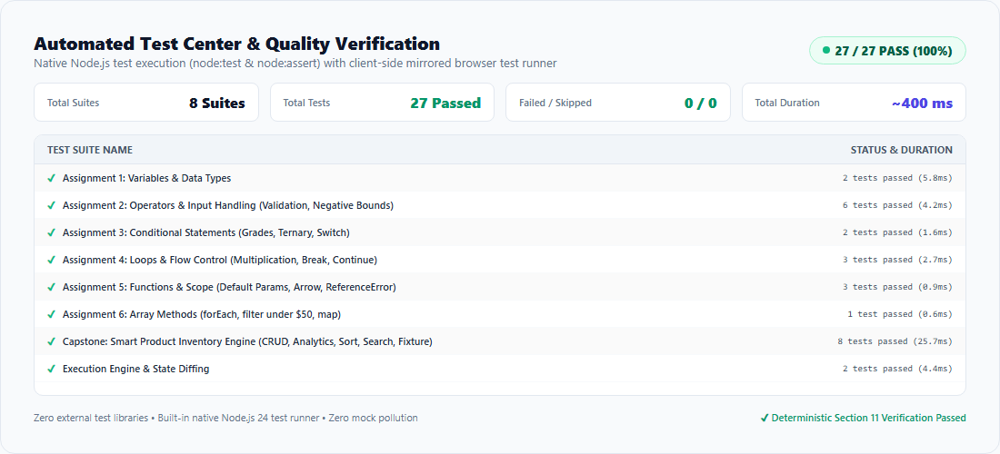

<div align="center">



# JavaScript Practical Learning Lab & Smart Inventory Analytics

[](https://developer.mozilla.org/en-US/docs/Web/JavaScript)
[](./tests/assignments.test.js)
[](./package.json)
[](./LICENSE)
[](./tests/assignments.test.js)

**A high-craft developer laboratory and interactive inventory analytics system built with zero-dependency Vanilla JavaScript (ES6+), semantic HTML5, and responsive CSS3.**

[Overview](#-system-overview) • [Curriculum](#-core-curriculum-modules) • [Capstone Engine](#-capstone-smart-inventory-system) • [Automated Tests](#-automated-test-center) • [Quick Start](#-quick-start-guide) • [LinkedIn Showcase](#-linkedin-showcase)

---

</div>

## 🌟 System Overview

The **JavaScript Practical Learning Lab** bridges foundational software engineering principles with production-grade data modeling. Designed with a clean, light-themed developer aesthetic, this system features a **6-stage progressive JavaScript laboratory** paired with a real-time **Smart Product Inventory Analytics Engine** and **dual-environment test verification** (Node.js native runner + in-browser execution runner).

<div align="center">
  
  <p><em>Figure 1: Full System Architecture, Live Inventory Dashboard, and 100% Passing Test Suite.</em></p>
</div>

### Key Architectural Highlights
- ⚡ **Zero External Dependencies:** Built entirely with web standards—no React, no jQuery, no bundling overhead.
- 🛡️ **Defensive Engineering:** Strict input typecasting (`Number()`), boundary guardrails, and non-numeric value rejection.
- 📊 **Functional Data Pipelines:** State transformations powered by pure higher-order functions (`Array.reduce`, `Array.filter`, `Array.map`).
- 🧪 **Dual-Environment Test Suite:** 27 assertions across 8 test suites running in **~400ms** in both Node.js 24 and client browsers.
- 🎨 **Modern Light Aesthetics:** Clean typography, curated color tokens, accessible contrast, and smooth micro-interactions.

---

## 📚 Core Curriculum Modules

The curriculum covers fundamental to intermediate JavaScript concepts through hands-on, verifiable interactive modules:

<div align="center">
  
  <p><em>Figure 2: The 6 Foundation Engineering Modules and Real-Time Verification Engines.</em></p>
</div>

| # | Module | Core Concepts Covered | Validation & Edge Cases |
|---|---|---|---|
| **01** | **Variables & Data Types** | `let`, `const`, `var`, primitive types (`string`, `number`, `boolean`, `null`, `undefined`), reference mutation, `typeof`, JSON serialization | Mutability guarantees, array references, primitive immutability |
| **02** | **Operators & Input Handling** | Restaurant tip calculator, arithmetic precedence, numeric casting via `Number()`, template literals | Non-numeric rejection, negative subtotals, blank inputs, tip % boundaries (0–100%) |
| **03** | **Conditional Statements** | Student grading engine, `if...else` input validation, multi-branch `switch` for letter grades (A–F), ternary pass/fail evaluation | Exact score boundaries (90, 80, 70, 60), negative scores (`-1`), overflow (`101`), non-numeric values |
| **04** | **Loops & Flow Control** | `for` loop multiplication tables (1 to 5), `while` search loop with `break`, `do...while` with `continue` skip logic | Loop termination guarantees, search short-circuiting, non-infinite loop safety |
| **05** | **Functions & Lexical Scope** | Default parameters, arrow functions, lexical `this`, block scope isolation, graceful `try...catch` error interception | Trapping block-scoped `ReferenceError` without application crashes |
| **06** | **Modern Array Pipelines** | Real-world product catalog transformations using `.forEach()`, `.filter()`, and `.map()` | Immutable projections, case-mapping, price threshold filters (< $50) |

---

## 💼 Capstone: Smart Inventory System

The centerpiece of the platform is an interactive **Smart Product Inventory Analytics System** that simulates real-world SaaS inventory management and financial projections.

<div align="center">
  
  <p><em>Figure 3: Real-Time Inventory Analytics, Dynamic Filters, Tiered Badges, and Financial Forecasting.</em></p>
</div>

### 1. Tiered Price Classification Engine
Products are classified automatically using immutable pricing boundaries:
- 🟢 **Budget Tier:** `< $50.00` (e.g., Wireless Mouse at `$29.99`, Multiport Hub at `$45.00`)
- 🔵 **Standard Tier:** `$50.00` to `< $200.00` (e.g., Mechanical Keyboard at `$120.00`, Monitor at `$150.00`)
- 🟣 **Premium Tier:** `≥ $200.00` (e.g., 4K Ultra HD Display at `$380.00`)

### 2. High-Order Analytics Metrics
The analytics engine dynamically computes operational KPIs across the active inventory without state mutation:
```javascript
// Total Inventory Valuation via Array.reduce
const totalValue = inventory.reduce((acc, item) => acc + item.price, 0);

// Affordable Inventory Segregation (< $200) via Array.filter
const affordableProducts = inventory.filter(item => item.price < 200);

// Product Category Tagging via Array.map
const catalogSummaries = inventory.map(item => ({
  summary: `${item.name.toUpperCase()} - $${item.price.toFixed(2)}`,
  tier: getTierCategory(item.price)
}));
```

### 3. Financial Forecast Estimator
Projects financial adjustments (tax additions and promotional discount reductions) through clean, side-effect-free calculations:
- **Tax Calculation:** `Total Value × (1 + taxRate)`
- **Promotional Discounts:** `Total Value × (1 - discountRate)`
- **Base Inventory Isolation:** Guarantees that projected financial figures do not mutate item records or cause rounding drift.

### 4. Deterministic Section 11 Verification
The system includes a deterministic verification fixture that adds `Monitor ($150)` and validates state consistency, item count, and financial projections against predefined benchmarks.

---

## 🧪 Automated Test Center

Quality assurance is verified via a **dual-engine testing strategy**: a native Node.js test runner for CI/CD and a client-side runner inside the browser interface.

<div align="center">
  
  <p><em>Figure 4: 27 Automated Tests Passing across 8 Test Suites with Zero External Dependencies.</em></p>
</div>

### Test Execution Summary

```text
▶ Assignment 1: Variables and Data Types
  ✔ returns expected variable values and runtime types (3.2ms)
  ✔ formats expected output string correctly (0.3ms)
▶ Assignment 2: Operators and Input Handling
  ✔ correctly calculates tip and total for valid numbers (0.7ms)
  ✔ correctly handles decimal calculations (0.4ms)
  ✔ rejects blank inputs (0.9ms)
  ✔ rejects non-numeric inputs (0.5ms)
  ✔ rejects negative subtotal (0.4ms)
  ✔ rejects invalid tip percentages (< 0 or > 100) (0.5ms)
▶ Assignment 3: Conditional Statements (Grades)
  ✔ computes letter grade and pass/fail for tested boundaries (0.6ms)
  ✔ rejects invalid scores (-1 and 101, non-numeric, blank) (0.7ms)
▶ Assignment 4: Loops and Flow Control
  ✔ generates 5 multiplication table from 1 to 5 (0.4ms)
  ✔ finds first number > 10 divisible by 6 using break (1.5ms)
  ✔ ensures loop termination and continue statement execution (0.5ms)
▶ Assignment 5: Functions and Scope
  ✔ evaluates standard function with default and custom arguments (0.2ms)
  ✔ evaluates arrow function area calculator (0.1ms)
  ✔ safely catches ReferenceError for block scope test (0.4ms)
▶ Assignment 6: Array Methods
  ✔ demonstrates forEach, filter, and map on product array (0.5ms)
▶ Capstone: Smart Product Inventory Engine
  ✔ categorizes products according to pricing rules and boundaries (0.7ms)
  ✔ adds valid product and rejects invalid product data (2.1ms)
  ✔ computes analytics using reduce, filter, and map (0.9ms)
  ✔ runs deterministic verification fixture matching Section 11 specifications (0.6ms)
  ✔ supports product removal by ID (0.5ms)
  ✔ supports search, filtering, and sorting (19.1ms)
  ✔ handles empty inventory without runtime errors (0.6ms)
  ✔ calculates financial estimates without mutating base inventory (0.8ms)
▶ Execution Engine & Diffing
  ✔ registers and executes assignments cleanly (3.9ms)
  ✔ detects differences when output differs (0.4ms)

ℹ suites: 8 | tests: 27 | pass: 27 | fail: 0 | duration_ms: ~400ms
```

---

## 📂 Project Architecture

```text
javascript-learning-lab/
├── docs/
│   ├── images/
│   │   ├── hero-banner.png         # Light-theme README header graphic
│   │   ├── inventory-dashboard.png # Smart Inventory analytics preview
│   │   ├── core-curriculum.png     # 6-module curriculum graphic
│   │   └── test-runner.png         # Native test runner report card
│   └── render_templates/           # Source templates for high-res asset rendering
├── css/
│   └── style.css                   # Custom responsive design system & tokens
├── js/
│   ├── assignments.js              # Assignments 1-6 core algorithms
│   ├── execution-engine.js         # Runtime manager, output diffing, state tracker
│   ├── inventory.js                # Capstone inventory CRUD, metrics, forecasting
│   ├── dashboard.js                # View coordinator, metrics aggregation
│   └── main.js                     # DOM bindings, interactive controls, browser test suite
├── tests/
│   └── assignments.test.js         # 27 Node.js native tests (node:test & node:assert)
├── image.png                       # LinkedIn Showcase Project Graphic (1280x720)
├── index.html                      # Interactive web application entrypoint
├── package.json                    # Project configuration and test commands
├── render-assets.js                # Automated Chrome headless asset generator
├── .gitignore                      # Git exclusion rules
├── LICENSE                         # MIT License
└── README.md                       # Comprehensive system documentation
```

---

## 🚀 Quick Start Guide

### 1. Clone the Repository
```bash
git clone https://github.com/maheswari9080/javascript-web-development-internship-mini-project.git
cd javascript-web-development-internship-mini-project
```

### 2. Run in Your Browser
No build tools or web servers are required. Open `index.html` directly in any modern browser:
```bash
# Windows
start index.html

# macOS
open index.html

# Linux
xdg-open index.html
```

Or serve locally with any static HTTP server:
```bash
npx serve .
# or
python -m http.server 8080
```

### 3. Run Automated Tests
Execute the native Node.js test runner:
```bash
npm test
```
Or run directly:
```bash
node --test tests/assignments.test.js
```

---

## 📢 LinkedIn Showcase

Ready to share your achievement on LinkedIn? Use the companion graphic [`image.png`](./image.png) alongside the post copy below:

> ### 🚀 LinkedIn Post Copy
>
> 🚀 Excited to share my latest full-stack milestone: **JavaScript Practical Learning Lab & Smart Inventory Analytics System**! 💻✨
>
> In this project, I set out to master core computer science and software engineering principles in pure **Vanilla JavaScript (ES6+)** with **zero external dependencies**.
>
> 🔍 **Key Highlights & Architecture:**
> 1. **Foundational Engineering (6 Modules):**
>    - Scope isolation (`let` / `const`), reference integrity, and JSON serialization.
>    - Defensive validation (`Number()`) rejecting non-numeric, negative, and out-of-bound inputs.
>    - Grading algorithms utilizing multi-branch `switch` and ternary operators.
>    - Controlled iteration (`for`, `while` with `break`, `do...while` with `continue`).
>    - Lexical closures, arrow functions, and `try/catch` error boundaries.
> 2. **Capstone — Smart Product Inventory Analytics Engine:**
>    - Dynamic CRUD operations with strict data validation.
>    - Tiered automated classification (Budget `< $50`, Standard `$50-$199.99`, Premium `≥ $200`).
>    - Functional data transformations using `reduce()`, `filter()`, and `map()`.
>    - Real-time search, sorting, and non-mutating financial estimators (tax and discounts).
> 3. **Dual-Environment Automated Testing:**
>    - 27 unit tests across 8 suites passing in ~400ms using Node.js native test runner (`node:test` & `node:assert`).
>    - Mirrored real-time client-side test execution inside the browser!
>
> 💡 *The biggest takeaway?* Building complex systems without relying on third-party frameworks deepens your understanding of language fundamentals, memory safety, and performance.
>
> 🔗 **Explore the Code & Live Demo:**
> https://github.com/maheswari9080/javascript-web-development-internship-mini-project
>
> What are your favorite Vanilla JS patterns? I’d love to connect and hear your thoughts! 👇
>
> #JavaScript #WebDevelopment #Coding #FrontendDevelopment #SoftwareEngineering #VanillaJS #CleanCode #LearningJourney #WebDev #NodeJS #OpenSource

---

## 📄 License

This project is open-source and licensed under the [MIT License](./LICENSE).

---

<div align="center">
  <sub>Crafted with passion for clean software engineering and modern JavaScript standards.</sub>
</div>
